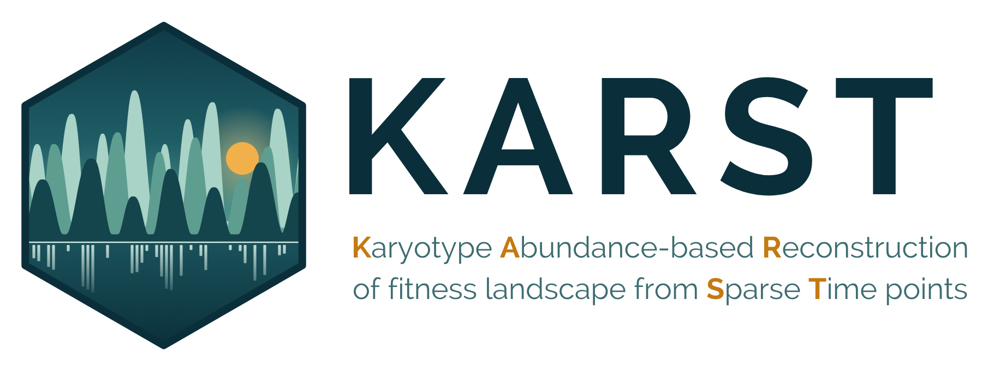

# KARST logo



## Idea

Tower-karst peaks over still water at dusk, in three layers. The peaks stand
for the fitness landscape: peaks and valleys over karyotype space. Below the
waterline the reflection is broken into sparse vertical bars, whose lengths
follow the front ridge at the bar positions. The bars are the observed
karyotype abundances, few and incomplete, from which the landscape above is
reconstructed.

## Files

| File | Use |
| --- | --- |
| `karst_hex.svg`, `karst_hex.png` (1040 × 1200) | Hex sticker with the name, R-package style |
| `karst_hex_small.png` (240 × 277) | Copied to `man/figures/logo.png`, the package logo shown in the top-level README |
| `karst_icon.svg`, `karst_icon.png` (1040 × 1200) | Hex without the name |
| `karst_icon_512.png`, `_180`, `_64`, `_32` | Square icons (transparent padding): avatar, apple-touch icon, favicons |
| `karst_wordmark.svg`, `.png` | Icon, name and the name spelled out, for light backgrounds |
| `karst_wordmark_dark.svg`, `.png` | The same for dark backgrounds |
| `build_logo.py` | Writes all of the above and `man/figures/logo.png` |

All PNGs have transparent backgrounds. The SVGs are the sources; their text is
converted to outlines, so they need no fonts installed.

## Colours

| Role | Hex |
| --- | --- |
| Border, wordmark text | `#0B2F3A` |
| Sky (top → horizon) | `#0E3946` → `#1F5E66` → `#5FA597` |
| Peaks (far, middle, front) | `#A9D3C7`, `#5E9E91`, `#14444C` |
| Water (top → bottom) | `#1A525B` → `#0B2F3A` |
| Waterline, reflection bars | `#D4EAE3` |
| Name on dark | `#EEF6F2` |
| Sun, initials on dark | `#F2B04A` |
| Initials on light | `#C47A12` |

## Font

Raleway Bold and Raleway Regular, SIL Open Font License 1.1.

## Rebuild

```sh
python3 doc/logo/build_logo.py
```

Needs Python with fontTools, Google Chrome (renders the PNGs, headless) and
ImageMagick (`magick`, downsizes them). The peak shapes, colours and text sizes
are set at the top of `build_logo.py`; the font and Chrome paths can be set
with `KARST_FONT_BOLD`, `KARST_FONT_REGULAR` and `CHROME`.
